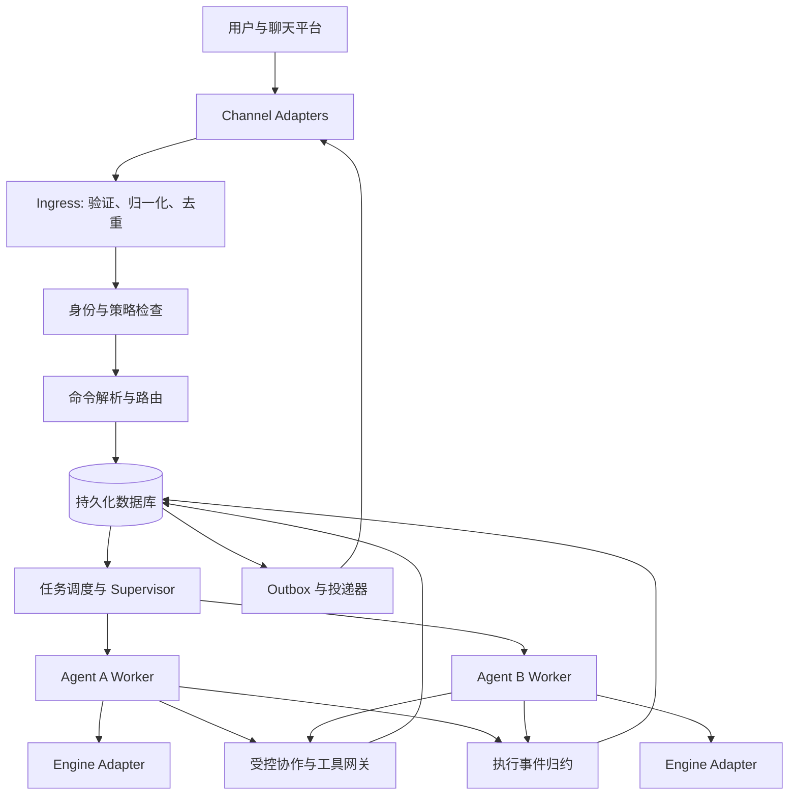

# 历史记录：早期系统架构方案

归档日期：2026-10-05。以下保留归档前原文，仅调整相对链接。原文的“当前”“已确认”“待实现”属于当时语境，不能作为现行接口或部署保证。现行入口见[当前设计](../current-design.md)。

---

> 2026-09-28 实施更新：用户已授权 Rust 实现，mac-cli 为主要控制面（mac 兼容）。个人使用、Codex 引擎、全局最多 20 个 worker；用户消息 steer，Agent query 使用配置副本和可复用协作上下文。先更新计划再实现的新增契约见 [CLI 控制面](../cli-control-plane.md)，可运行能力、验证结果及剩余工作见 [README](../../README.md)。本文后续早期“仅规划/待授权”状态已被覆盖，未实现条目仍为目标设计。

# multi-agent-on-chat 详细架构草案

版本：v0.7，2026-09-27。状态：待讨论，禁止据此直接开始实现。

## 1. 依据与边界

已确认：项目目录为 `~/projects/multi-agent-on-chat`；本阶段只设计；所有细节经用户确认后才开始实现。用户进一步明确：Bot + Agent 共同定义完整的权限及功能，部分信息需要由 Bot 提供。用户已接受首版一个 Agent 实例固定属于一个 Bot、一个 Bot 管理多个 Agent；跨 Bot 复用可配置新建的 AgentTemplate，不共享实例。此前讨论的其他具体需求尚未补齐，以下未明确确认的细节均为建议。

参考资料为本机 `~/projects/codex-on-wechat/architecture.md` 和 `plan.md`，不是新的需求承诺，也未逐项审计其代码实现。旧文档描述了多渠道接入、每个 Agent 独立进程、SQLite 持久化、任务租约、Agent 邮箱及原入口回复等机制。新项目与旧项目的继承关系仍需确认。

建议目标：通过聊天入口管理多个长期存在的 Agent，提交与追踪任务，并允许受控的跨 Agent 协作。建议第一版部署于单台主机；多机调度、公开 SaaS、多租户容器编排暂列为待议扩展。首批渠道、Agent 引擎、个人或团队使用模式尚未确定。

## 2. 领域对象与术语

| 对象 | 含义与约束 |
| --- | --- |
| Principal | 系统中的用户或服务身份；跨平台身份必须显式绑定 |
| Bot | 面向用户的服务入口，定义入口功能、权限边界及其提供的上下文；不等同于底层渠道连接 |
| ChannelAccount | 一个具体平台机器人账号，独立凭据、健康状态与权限 |
| AgentTemplate | 可跨 Bot 复用的版本化配置模板，创建独立实例，不携带运行状态或实际授权 |
| Conversation | 平台、机器人账号、租户、聊天、话题共同限定的会话 |
| Route | 会话到当前 Bot 下接待 Agent 实例的映射，带版本号 |
| Agent | 固定归属一个 Bot 的长期实例，保存模板快照、引擎配置、角色、工作区及能力策略 |
| Session | 某 Agent 在某上下文中的引擎会话；不同来源默认不合并 |
| Task | 一次用户工作请求，可包含多次执行尝试及协作子任务 |
| Run | Task 的一次实际执行，固定配置快照、租约与进程代次 |
| Message | 用户、Agent 或系统产生的持久化内容及附件引用 |
| Artifact | 输出文件及其来源、所有权、校验和与保留策略 |
| CollaborationRequest | 有授权范围、截止时间与回复上限的跨 Agent 请求 |
| Delivery | 向确定渠道入口发送某条消息的投递记录 |

Agent、Session、Task、Run 分开建模，避免把“切换 Agent”“清空上下文”“重试任务”“重启进程”混为同一个操作。

用户当前倾向 Conversation Context 由 Agent 维护，Bot 信息渐进披露。建议由 Agent Runtime / Session Manager 管理历史、摘要和引擎会话；Bot Context Provider 按需提供入口信息；Identity / Policy 与运行时持有可信身份和权限。执行上下文与模型可见输入分开，不把所有 Bot 信息预先注入提示词。具体职责和身份来源见 [组合契约第 8 节](../bot-agent-contract.md#8-conversation-context渐进披露与身份来源)。

持久化命名 Agent 与一次任务内的临时子 Agent 也需区分。建议首版只支持注册 Agent 之间的委派；如纳入自动创建临时 Agent，须额外定义所有者继承、生命周期、最大数量、工作区回收及子任务审计，不将引擎内部子 Agent 自动视为平台注册 Agent。

## 3. 总体结构

Bot 是业务领域对象，Channel Adapter 是技术接入组件；不能将两者合并。Bot + Agent 的组合才形成用户实际可用的服务，详见 [Bot 与 Agent 的组合契约](../bot-agent-contract.md)。下图中的身份、路由和调度均需使用该组合；Worker 不自行从渠道原始数据推导权限。



建议使用模块化单体控制平面，加独立 Agent Worker 进程。控制平面负责身份、权限、路由、调度、状态与投递；Worker 负责调用引擎与上报事件。首版无需引入微服务或消息中间件。

## 4. 模块职责与接口

| 模块 | 职责 | 主要边界 |
| --- | --- | --- |
| channels | 平台认证、收发、附件、速率限制、能力声明 | 平台特有字段留在适配器及来源元数据中 |
| ingress | 签名/来源验证、规范化、去重与持久化接收 | 平台允许时，持久化成功后才确认接收 |
| identity/policy | 身份绑定、资源授权与执行能力 | 每次入口与敏感操作均校验，默认拒绝未授予能力 |
| commands/routing | 确定性命令、会话路由与任务创建 | 普通聊天不直接改变权限或系统配置 |
| tasks/scheduler | 排队、租约、资源预算、取消与恢复 | 数据库为事实来源，内存队列只作唤醒 |
| supervisor | Worker 启停、心跳、代次与异常清理 | 不持有引擎对话内部状态 |
| engines | 不同 Agent 引擎的启动、恢复、事件转换 | 不直接访问聊天平台或业务数据库 |
| collaboration | 持久化邮箱、请求关联、委派权限 | 联合校验调用服务的权限、接收方执行上限、委派合同与任务限制 |
| delivery | 分段、编辑、附件投递、重试 | 执行成功与消息投递成功分别记录 |
| storage/artifacts | 事务、迁移、附件存储和访问检查 | 数据库单写入所有者；Worker 经 IPC 上报 |
| admin/observability | 健康、审计、日志、配置检查 | 运维接口权限独立于普通聊天权限 |

建议统一入站结构：`event_id, provider, account_id, tenant_id, conversation_id, topic_id, sender_ref, received_at, content[], source_metadata`。`content` 为文本、图片、音频、文件等有类型的元素。验证后由服务端解析 bot_id、归属于该 Bot 的 agent_id 与 principal，结合 BotContext 构造执行上下文；不接受用户或模型自行指定这些字段作为权限依据。原始数据按有限保留策略保存，不默认写入普通日志。

建议统一引擎接口：`capabilities()`、`start_session()`、`resume_session()`、`run(input, context)`、`cancel(run_id)`、`close()`。引擎不支持恢复、流式事件或运行中追加消息时，明确返回能力缺失；不伪装成支持。接口字段与具体 SDK/CLI 选择需在引擎确定后定稿。

## 5. 进程、并发与工作区

已确认协作使用目标 Agent 下的临时会话，仅继承配置，多轮复用自己的最新上下文。同一会话串行，不同协作会话可在限额内并行，不再采用每 Agent 全局单执行槽。按 Agent 管理 Worker 加独立会话执行器或按活动会话建进程的物理布局待定，详见 [临时协作会话](../collaboration-sessions.md)。

Worker 使用独立启动的解释器和私有本地 IPC。握手包含协议版本、agent_id、worker_generation；执行事件带 run_id、租约 token 与 event_seq。控制平面拒绝旧代次、失效租约和重复事件。仅通信身份校验不能构成同一系统用户下的恶意代码安全隔离。

用户希望通过 Bot 发来的消息直接 steer，具体引擎能力与生效时机仍待核实。同一协作的后续消息必须续接原临时会话，忙时 steer/排队语义待定；不隐式新建另一份上下文或取消任务。调度按用户/Agent 公平取队列。

工作区默认按项目显式选择。Git 项目中的并行修改建议使用独立 worktree；非 Git 项目按目录申请写入租约或分配独立输出目录。对同一工作目录的写入冲突检测与人工已有修改保护必须有清晰规则。合并、发布和外部写入遵循用户已授予的权限。

独立进程提供故障隔离，不提供文件与凭据保密。若允许不可信用户或代码，需在第一版选择容器、系统身份或工具代理形成实际隔离，不能延后到上线后补充。

## 6. 核心交互流程

### 6.1 用户提交任务

1. 渠道适配器接收事件，验证来源并生成稳定去重键。
2. 在数据库事务中记录 Inbox、消息、授权判断、路由快照及 Task；重复事件返回既有接收结果。
3. 事务提交后确认接收，并通过 Outbox 发送任务已接收反馈。
4. 调度器原子获取执行槽和租约，创建 Run 与能力快照，通知 Worker。
5. Worker 输出事件；控制平面先持久化、去重，再更新任务状态与回复视图。
6. 终态与终态通知在同一事务中写入，投递器异步发送。

适配器必须记录平台是否提供可重放事件或接收确认能力；平台无重放保证时，明确接收前崩溃可能造成的丢失边界。

### 6.2 切换 Agent

切换只更新当前 Conversation 的 Route。已有 Task 持有接收时的 Agent、Session 与回复入口快照，继续原任务；不得因后续切换把回复发送到另一聊天或机器人。是否把旧上下文摘要带给新 Agent，必须由用户显式选择。

### 6.3 Agent 协作

已确认需要 Agent 间通讯，Agent 使用所属 Bot 的身份执行。建议通讯由内部持久化 Mailbox 承载，始终记录 Agent 与所属 Bot；接收方用自己的 Bot 身份执行，不能继承发送方凭据。首版已确认包含经过显式授权的跨 Bot 通讯；Agent 实例仍固定归属，具体授权配置待定。详见 [Agent 通讯与执行身份](../agent-communication.md)。

Agent A 通过受控网关请求 B，附带目标、最小上下文、截止时间、幂等键与预算。网关检查目标可见性、任务能力与协作策略后持久化请求，为 B 创建工作项。B 的结果先进入 A 的持久化邮箱，再由 A 汇总到原用户任务。

Worker 不同步阻塞等待另一个 Worker。父任务如需等待子任务，应保存 continuation 并释放执行槽；引擎不能暂停恢复时，结束当前轮次，后续以新 Run 消费结果。设置最大深度、请求数、总运行预算、超时与循环检测；A→B→A 的同一调用链不得无限递归。迟到结果存档，但不自动重开已取消父任务。

跨 Agent 文本是任务数据，不能改变授权。父任务取消默认向未完成子任务传播；已授权为独立任务的工作可继续，此语义需确认。

请求的真实 sender、principal 与父任务由网关根据认证连接和有效能力解析，不能相信模型在参数中声明的身份。启动时的任务快照用于限定权限上界，实时撤权检查用于进一步缩小权限。

### 6.4 取消、异常与恢复

取消先持久化 `cancel_requested`，再发引擎取消；超时后终止 Worker 进程组并确认退出。收到取消时若成功终态已先提交，则返回任务已完成。尚未确认终止时不显示为已取消，使用 `interrupted` 或需人工处理状态。

Supervisor 重启后从数据库重建路由、待执行任务、邮箱和 Outbox。活动 Run 租约失效后标记 interrupted，检查旧进程是否仍存活，再决定恢复或重试。不得只因超时就并发重跑可能仍在执行的任务。

读操作可按重试策略重跑；已经产生外部副作用的 Run 必须依据操作幂等键及外部结果回执恢复。无法判断是否生效时转入 `needs_attention`，避免重复发送消息、提交或支付等操作。

## 7. 状态机与一致性

建议 Task 状态：`queued → running → succeeded | failed | cancelled`，另设 `waiting_input`、`waiting_dependency`、`cancel_requested`、`interrupted`、`needs_attention`。Run 保存单次执行状态与失败原因。投递失败不把已成功的 Task 改为执行失败。

| 当前状态 | 事件 | 下一状态与处理 |
| --- | --- | --- |
| queued | 获得槽位与租约 | running，创建 Run |
| running | 需要用户输入/依赖 | waiting_input / waiting_dependency，保存恢复点 |
| waiting_* | 输入/依赖到达 | queued，以新 Run 或显式引擎恢复继续 |
| queued / waiting_* | 取消 | cancelled，撤销待处理工作 |
| running | 取消请求 | cancel_requested，发出停止信号 |
| cancel_requested | 已确认停止 | cancelled |
| running / cancel_requested | Worker 丢失 | interrupted，进入恢复判定 |
| interrupted | 可安全恢复 | queued |
| interrupted | 副作用不明 | needs_attention |
| running | 成功/失败终态 | succeeded / failed，创建通知 |

所有转换使用版本条件更新，终态提交幂等；取消与成功竞争以数据库提交顺序确定。Worker 对已被 fence 的 Run 上报终态仅留审计，不覆盖新状态。

保证目标是持久化接收后的工作至少处理一次、内部事件幂等归约；不承诺端到端 exactly-once。平台支持客户端幂等键时使用；发送成功但写回确认前崩溃、且平台不支持去重或查询时，重复投递无法完全消除。

## 8. 数据模型与存储

建议首版 SQLite WAL，所有写事务由控制平面中的存储模块管理，事务内不执行网络调用；附件存放文件系统。若确认需要多实例写入、HA 或大量团队使用，则在实施前改选 PostgreSQL。

| 表组 | 核心字段或唯一性 |
| --- | --- |
| principals / identity_bindings | 平台+账号/应用范围+租户+用户 ID 唯一映射 |
| channel_accounts / conversations | 具体机器人与 chat/topic 范围，凭据只存引用 |
| bots / bot_configs | Bot 身份、入口功能与策略、上下文提供器及配置版本 |
| agent_templates / template_versions | 模板所有者与可见范围、不可变版本、schema 版本、内容摘要 |
| agents / agent_configs | 固定 bot_id、所有者、模板版本与解析快照、引擎、workspace、config_revision |
| routes / sessions | 会话范围、Agent、版本、引擎 session_ref |
| inbox_events / messages | 平台作用域内 source_event_id 唯一；消息不可变来源 |
| tasks / runs / run_events | 父任务、配置快照、租约、generation；run_id+seq 唯一 |
| collaboration_requests / mailbox | sender、recipient、parent_task、幂等键、deadline、消费状态 |
| outbox / deliveries | 业务通知键、destination_snapshot、分段号、attempt、next_retry_at |
| artifacts / artifact_refs | 内容摘要、大小、类型、实际路径、访问范围 |
| capabilities / audit_events | 能力范围、过期时间、授权版本、撤销与行为审计 |
| schema_migrations | schema 版本、校验信息与应用时间 |

消息流、Task 状态、Outbox 使用事务保持一致。采用当前状态表加不可变关键事件记录，不在首版建设完整事件溯源系统。主键建议使用可跨导入的 UUID；时间统一存 UTC，用户展示保留时区。

附件下载到临时文件，校验体积、类型与路径后原子发布；禁止把外部文件名直接作为任意磁盘路径。配额、保留期、删除宽限与引用计数需确定。备份必须包含一致性数据库快照、被引用附件和配置；密钥另行备份。

## 9. 权限与安全

建议采用资源作用域授权：用户对 Agent、项目、会话和管理操作分别拥有权限；执行能力限定到 Task/Run。角色可提供 owner/operator/member 等预设，但最终角色表取决于单用户或团队模式。

授权必须同时校验 Bot 入口与 Agent 能力，以及实例策略的限制。平台授予 Bot 的权限只是技术上限，不能替代用户授权；用户在某 Bot 有权限，也不意味着可以访问该 Bot 所绑定 Agent 的全部能力。组合判定与上下文可信度见 [组合契约](../bot-agent-contract.md)。

首版按平台作用域识别身份，不自动跨平台合并；未来若支持跨平台关联，必须有验证的绑定流程。群聊成员不自动获得私有 Agent、项目文件或私人会话的读取权限。任务输出在发送前检查目标会话可见性；请求者离群等权限变化要重新检查。

能力快照禁止执行中扩大权限；网关同时检查实时撤销状态。Worker 只获得完成任务必要的凭据；机器人渠道凭据由适配器持有。密钥存系统凭据库或权限受限文件，数据库保存 key reference，日志与错误信息脱敏。

提示词约束不算安全边界。沙箱外工具调用、任意 shell 与同 UID 文件读取的限制，应由运行环境或工具网关实际执行。高风险动作是否需要逐次确认依据用户授权与最终产品策略确定，不把普通可逆操作统一变成审批。

## 10. 渠道行为与用户体验

各渠道声明文本长度、编辑能力、引用/话题、附件大小和格式、事件重放及幂等发送能力。核心只产生语义消息，适配器负责表现与降级。

建议普通对话归当前 Agent；`/agents`、`/use`、`/new`、`/status`、`/cancel`、`/tasks` 等作为确定性命令候选，实际名称与兼容旧命令范围待确认。错误命令不透传给模型执行管理操作。

长任务先发接收回执，再合并限频的阶段更新，最后发送结果。消息分段按固定序号投递；某段失败只重试该段，不重发已确认段。回复快照绑定账号、chat、topic、原消息及请求者，渠道失效时保留待投递状态，不自动改投其他私聊。

引擎 token 片段不等于用户通知；进度节流与持久化检查点分开设计，避免每 token 写库或发送消息。音频转写、图像理解、卡片按钮、主动通知均按首版需求单独确认。

## 11. 配置、可观测性与运维

建议项目配置描述渠道、引擎、Agent、工作区与策略；密钥不进入项目仓库。运行时用户操作更新数据库状态，配置导入采用显式版本校验，避免配置文件与数据库双向覆盖。每个 Run 固定配置版本，热更新只作用于新 Run，撤权立即生效。

结构化日志关联 `account_id/conversation_id/task_id/run_id/agent_id`，默认不记录完整消息和提示词。指标包括入站延迟、队列年龄、Worker 心跳、运行耗时、引擎错误、投递重试、附件容量及可获取的用量/费用。健康检查分别报告控制平面、存储、渠道和引擎，不把局部失效变成整体存活失败。

优雅退出：停止接新任务，持久化检查点，限时结束活动 Run，停止 Worker，保留未发送 Outbox。启动互斥锁防止同一实例目录被两套 Supervisor 同时占用；迁移前备份，迁移失败停止启动，不带损坏状态继续运行。

## 12. 可选能力：定时任务

用户已要求参考 codex-on-wechat 设计 cron，详见 [定时任务设计](../cron-design.md)。已确认每次触发独立临时会话、Job 固定配置版本、同 Job 未完成时跳过重叠触发。建议 Job 与 Occurrence/Task 分离，持久化去重、原入口投递并限制停机补跑。自然语言建议草案后续输入确认。首版范围与具体策略仍待确认。

## 13. 建议技术与目录（尚未创建代码）

已确认 Rust 控制平面与 CLI，首个引擎 Codex。建议 Tokio 异步调度 + SQLite WAL + 本地 IPC + 文件系统附件；具体版本、存储驱动、Codex 协议及部署环境仍待核实，旧 Python 建议已被替代。

```text
multi-agent-on-chat/
  docs/              架构、决策、协议与验收场景
  src/               待批准后创建
    channels/ ingress/ identity/ policy/
    commands/ routing/ tasks/ supervisor/
    engines/ collaboration/ delivery/
    storage/ artifacts/ admin/
  tests/             待批准后创建
  migrations/        待批准后创建
```

建议外部运行数据目录独立于 Git 仓库，支持显式 `data_dir`。日志、数据库、附件与临时工作区分开管理。不得直接复用旧项目的生产数据库、凭据目录或进程锁。

## 14. 验收场景（仅设计，不执行）

1. 同一入站事件重复到达，仅创建一个用户 Task。
2. 不同协作会话在限额内并行；同一 Session 不并发损坏上下文。
3. 切换 Agent 后，旧任务仍经原机器人、原会话和原话题回复。
4. Worker 崩溃不影响其他 Agent；过期 Worker 的终态不覆盖新 Run。
5. Supervisor 在提交终态后、发送前崩溃，重启可继续投递。
6. 发送成功而确认丢失时，按平台能力去重或明确记录重复风险。
7. 取消与完成竞争有确定结果；未知外部副作用不被盲目重放。
8. 协作循环、超时及晚到回复受到预算和状态机约束。
9. 群聊不能读取其他用户私有会话；撤权后新工具操作被拒绝。
10. 同一项目并发写入、附件路径穿越和超配额输入被正确处理。
11. 数据备份可恢复任务、附件与待投递消息；日志不暴露凭据。

## 15. 从设计到实现的条件

先完成 `decisions.md` 中全部适用决策，将无法在首版支持的内容明确列为范围外；再补齐选定渠道与引擎的具体协议、字段约束、错误码、超时、配额和部署参数。用户确认最终架构版本并明确允许实现后，才创建代码、安装依赖、启动服务或迁移数据。当前草案不满足实现条件。优先确认项见 [当前架构与确认事项](../architecture-review.md)。
